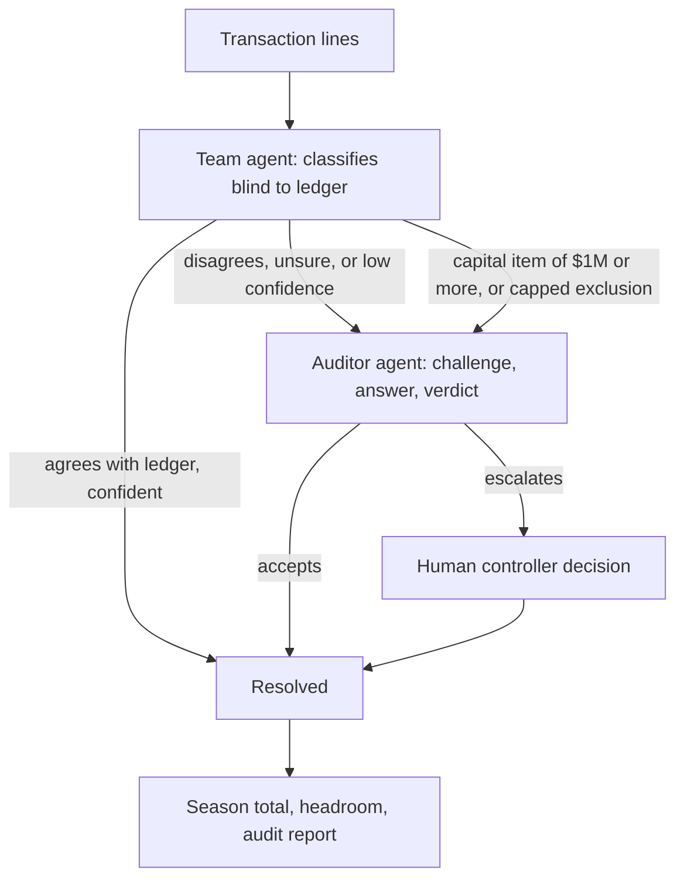

# CAPPY: an AI cost-cap compliance agent for F1 teams

> Prototype built on fictional data. Not affiliated with the FIA. Not
> legal or accounting advice.

## What it does

CAPPY decides which of an F1 team's expenses count toward the FIA cost
cap ($215M for 2026, Article D4.1.2). Accountants make these calls by
hand today. CAPPY uses two AI agents that check each other and hands the
hard calls to a human.

## How it was built

Built by Tarush Garg and Leo Chen.

We built CAPPY mostly by "vibe coding": describing what we wanted to
Claude, running what it produced, and steering it through many rounds of
testing and correction. Some of the early-stage code was written by hand
by Tarush, and Tarush coded parts of it alongside Claude. Much of the
code, though, was written by Claude, and our job was to direct it, test
it on the real FIA document, and decide what was right.

- **claude.ai** is where the app lives. It is a single HTML file that runs
  as a Claude artifact, and its live mode uses the viewer's own Claude
  account.
- **Claude Code** was used for repository files such as the docs.
- **The official FIA PDF** was our test bench. Most of the real bugs only
  appeared when we ran the agents on the actual Section D text.

### What went wrong along the way, and what we changed

- The first versions used a plain-English summary of the rules. We moved
  to the official Iss 08 PDF.
- The agents claimed rules were missing from the PDF, because we sent
  them search snippets instead of the full articles. We now send the
  complete exclusion list and definitions to both agents.
- One agent cited an article that did not match the text. Every citation
  is now checked against the loaded PDF.
- The page merged the 2027 changes (Appendix D2) into the 2026 rules. It
  now keeps them out.
- Lines the agents had escalated were still being counted, which created
  a false cap breach. Escalated lines now stay out of the season total
  until a human decides.
- While testing, one answer-key entry had been changed to match the
  app's output. We caught it and restored it.

## How it works

1. **Team agent** classifies every line against the FIA 2026 Financial
   Regulations (Section D, Iss 08). It never sees the manual ledger, so it
   cannot copy the accountants' mistakes. For each line it returns a
   verdict, the amount that counts, a confidence score, the article it
   relied on and a one-sentence reason.
2. **Routing.** A line goes to the Auditor if the Team agent disagrees
   with the ledger, its confidence is below the threshold (80% by
   default), or it is unsure. Capped exclusions (power unit supply,
   bonuses) never clear automatically. Capital items of $1M or more
   always go to a human.
3. **Auditor agent** challenges each flagged line in a three-step
   exchange (challenge, answer, verdict). Each step is a separate call
   to Claude.
4. **A human decides** what the agents cannot settle. Each option shows
   the effect on the season total and headroom before the choice is made.
5. **Audit report** with every line, its basis and reasoning, and a
   decision log, downloadable as Markdown and CSV.

## Features

- **Scripted demo:** a pre-written walkthrough that plays identically every
  time. It does not call Claude.
- **Live AI:** every decision is a real call to Claude. Requires a Claude
  account.
- Test your own expense in plain English.
- Import your own transactions by CSV (up to 40 rows) with a template.
- Load the official FIA PDF. The page reads it in the browser.
- Accuracy check: 20 fictional test invoices scored against an answer key.
- Audit report, CSV export, Stop and Reset, clear error and loading states.
- Invoice text is treated as data, never as instructions.

## Rules source

The live agents use the FIA 2026 F1 Regulations, Section D (Financial, F1
Teams), Iss 08, 1 October 2026, which you load yourself from fia.com. The
PDF is not included in this repository.

On that PDF the parser finds D5.1.1 with 27 items (a to aa), D5.1.2 with
10 (a to j), D6.1.1 with 17 (a to q) and 13 definitions from Appendix D1.
All of it is sent to both agents. Appendix D2 (approved changes from 2027)
is kept out of the 2026 rules. Every article label the agents cite is
checked against the loaded PDF; a label that does not exist shows as
"article label not found".

## Design decisions

- **Two independent agents.** One classifies, one challenges. A single
  model reviewing its own answer tends to confirm it.
- **Blind first pass.** The Team agent never sees the manual ledger.
- **A human for the hard calls.** The agents escalate instead of guessing,
  and the cost of each choice is shown before it is made.
- **Complete articles, not keyword search.** Both agents get the full
  exclusion list and the definitions.
- **Citations are checked** against the PDF text.
- **Caps are never assumed.** Exclusions limited by a maximum (power unit,
  bonuses) go to a human unless the cap is evidenced.
- **Items of $1M or more go to the controller.** This is the fictional
  team's own control (Control 3), not an FIA rule.
- **Scripted mode** gives a reliable walkthrough when live calls are slow
  or unavailable.
- **One HTML file running as a Claude artifact.** It uses the viewer's own
  Claude account, so there is no backend and no API key anywhere in this
  repository.

## Accuracy

We ran the 20-invoice check four times on the final version. Scores ranged
from 17 to 19 of 20, and every run correctly escalated the 2 lines the key
expects to go to the controller (#10 and #19). The rest of the gap came from
lines escalated where our answer key expected a definite answer, and which
lines those were varied between runs: #9, #11 and #12 in two runs; #11, #12
and #18 in a third; and only #9 in the fourth (19 of 20). The answer key was
drafted with Claude and checked against the PDF by us. It is small, so treat
this as a smoke test, not a benchmark. `tests/accuracy-results.csv` holds the
19 of 20 run.

## Limitations

- Live answers vary between runs.
- Live mode is slow: about 38 seconds to first output and 2.5 to 3
  minutes for the 16-line sample.
- The agents can pick an article label that exists in the PDF but is the
  wrong one for the line.
- Some figures the rules depend on (such as the maximum power unit price
  in Section A) are not in Section D, so those lines escalate.
- The team, vendors, amounts and invoices are fictional.
- Live mode and downloads work only inside claude.ai, with a Claude
  account. A local copy of `index.html` runs the scripted demo only.

## Running it

- **Scripted demo:** open `index.html` in a browser.
- **Live AI:** run the page as a Claude artifact in claude.ai, switch to
  Live AI, and load your copy of the Section D PDF.

## Repository

- `index.html`: the whole app
- `rules/`: link to the official regulations
- `tests/`: accuracy-check results
- `docs/`: screenshots and architecture notes

Not affiliated with the FIA. Fictional data. Not legal or accounting advice.
