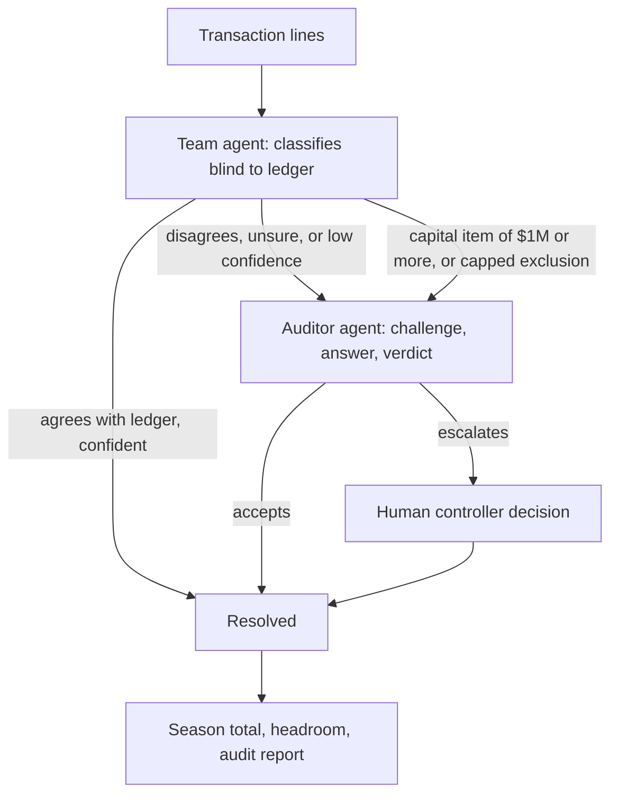

# Architecture

CAPPY is one HTML file that runs as a Claude artifact. It has no backend.
Live mode uses the viewer's own Claude account. Two AI agents check each
other, and a human controller makes the calls they cannot settle.

## Team agent

The Team agent classifies every transaction line against the FIA 2026 F1
Regulations, Section D, Iss 08. It never sees the manual ledger, so it
cannot copy the accountants' mistakes. For each line it returns:

- a verdict
- the amount that counts toward the cap
- a confidence score
- the article it relied on
- a one-sentence reason

## Routing

A line goes to the Auditor if any of these hold:

- the Team agent disagrees with the ledger
- its confidence is below the threshold (80% by default)
- it is unsure

Capped exclusions such as power unit supply and bonuses never clear
automatically. Capital items of $1M or more always go to a human. That
threshold is the fictional team's own control (Control 3), not an FIA rule.

## Auditor agent

The Auditor challenges each flagged line in a three-step exchange:
challenge, answer, verdict. Each step is a separate call to Claude. The
Auditor either accepts the line or escalates it.

## Human controller

A human decides every line the agents escalate. Each option shows its
effect on the season total and headroom before the choice is made.
Escalated lines stay out of the season total until a human decides.

## Checks and output

- Both agents get the complete exclusion list and definitions from the
  loaded PDF, not keyword search results.
- Every article label the agents cite is checked against the loaded PDF.
- The audit report lists every line, its basis and reasoning, and a
  decision log. It downloads as Markdown and CSV.

